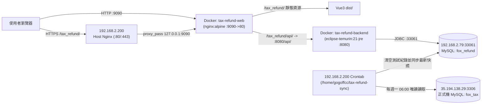

# 部署與維運手冊 (Deployment & Operations Guide)

本文件記錄新版「進口退稅核銷管理系統」於測試／雙軌並行主機（`192.168.2.200`）之 Docker 部署架構、Nginx 反向代理設定、一鍵部署流程及日常維運指令。

---

## 一、 環境與主機拓樸總覽



| 角色 | 主機 IP / 位置 | 埠號 / 路徑 | 帳號 / 憑證與說明 |
| :--- | :--- | :--- | :--- |
| **應用與排程主機** | `192.168.2.200` (Ubuntu) | SSH `22` / Web `9090` | 系統帳號：`gogoffcc`（已配置本機 SSH Key 免密登入） |
| **新版資料庫 (UAT/並行)** | `192.168.2.79` (`cloud-db`) | `33061` | Schema: `fox_refund` / User: `fox` |
| **舊版正式機資料庫** | `35.194.138.29` | `3306` | Schema: `fox_tax` / User: `fox`（僅供同步腳本唯讀查詢） |

---

## 二、 `192.168.2.200` Docker 部署架構

* **遠端部署目錄**：`/home/gogoffcc/tax-refund/`
* **專案版控對應目錄**：[`deploy/`](file:///c:/git/tax_Refund/deploy/)

### 1. 目錄結構
```text
/home/gogoffcc/tax-refund/
├── docker-compose.yml   # 容器編排設定 (定義 backend 與 web 服務)
├── nginx.conf           # 容器內 Nginx 設定 (處理 /tax_refund/ 靜態檔與 /tax_refund/api/ 轉發)
├── tax-api.jar          # 後端 Spring Boot 執行檔 (由 backend/tax/target/tax-0.0.1-SNAPSHOT.jar 上傳)
└── dist/                # 前端 Vue 3 打包靜態檔 (由 frontend/dist/ 上傳)
```

### 2. 容器設定說明（[`deploy/docker-compose.yml`](file:///c:/git/tax_Refund/deploy/docker-compose.yml)）
* **`tax-refund-backend`**：
  * 使用 `eclipse-temurin:21-jre` 映像檔，掛載 `./tax-api.jar:/app/app.jar:ro`。
  * JVM 記憶體參數：`-Xms256m -Xmx1024m`。
  * 透過環境變數注入 `DB_URL`、`DB_USERNAME`、`DB_PASSWORD`、`JPA_SHOW_SQL=false`。
* **`tax-refund-web`**：
  * 使用 `nginx:alpine` 映像檔，映射主機埠號 `9090:80`。
  * 掛載 `./dist:/usr/share/nginx/html:ro` 與 `./nginx.conf:/etc/nginx/conf.d/default.conf:ro`。

---

## 三、 Nginx `/tax_refund/` 子路徑反向代理設定

由於系統掛載於 `https://testotms.gogoffcc.com/tax_refund/` 子路徑下，採用「**主機 Nginx 不剝除前綴轉發 + 容器內 Nginx 對應 `/tax_refund/`**」的雙層架構（與同主機的 `/ams/` 架構一致）：

### 1. 主機端 Nginx 設定（`192.168.2.200:/etc/nginx/sites-enabled/default`）
```nginx
# 進口退稅核銷管理系統測試站 (docker tax-refund-web :9090)
location /tax_refund/ {
    proxy_set_header Host $http_host;
    proxy_set_header X-Real-Ip $remote_addr;
    proxy_set_header X-Forwarded-For $proxy_add_x_forwarded_for;
    proxy_set_header X-Forwarded-Proto $scheme;

    proxy_connect_timeout 60s;
    proxy_read_timeout 300s;
    proxy_send_timeout 300s;

    proxy_http_version 1.1;
    proxy_set_header Connection "";

    proxy_pass http://127.0.0.1:9090;
}
```
> **注意**：`/etc/nginx/sites-enabled/default` 內有兩個 `server` 區塊（第 88 行的無網域預設區塊，以及第 139 行的 `server_name testotms.gogoffcc.com;` 區塊）。若需同時支援網域與純 IP (`http://192.168.2.200/tax_refund/`) 不帶埠號存取，兩個 `server` 區塊皆可放入上述 `location /tax_refund/` 設定。修改後執行 `sudo nginx -t && sudo systemctl reload nginx`。

### 2. 前端與容器內 Nginx 關鍵配合設定
* **前端 [`frontend/vite.config.js`](file:///c:/git/tax_Refund/frontend/vite.config.js)**：設定 `base: '/tax_refund/'`，使打包後的靜態資源路徑皆帶有 `/tax_refund/assets/...` 前綴。
* **前端 [`frontend/src/utils/request.js`](file:///c:/git/tax_Refund/frontend/src/utils/request.js)**：`baseURL` 設為 `` `${import.meta.env.BASE_URL}api` ``（即 `/tax_refund/api`）。
* **容器內 [`deploy/nginx.conf`](file:///c:/git/tax_Refund/deploy/nginx.conf)**：
  * `location /tax_refund/api/`：轉發至 `http://backend:8080/api/`。
  * `location /tax_refund/`：使用 `alias /usr/share/nginx/html/;` 並配置 `try_files $uri $uri/ /tax_refund/index.html;` 支援 Vue Router History 模式。
  * `location = /`：自動 `302` 跳轉至 `/tax_refund/`，方便直接造訪 `http://192.168.2.200:9090` 時自動進入系統。

---

## 四、 一鍵打包與更新部署流程

當本機修改完後端或前端程式碼後，只需在專案根目錄執行 [`deploy/deploy-to-200.ps1`](file:///c:/git/tax_Refund/deploy/deploy-to-200.ps1)，即可自動完成「後端 Maven 打包 -> 前端 Vite 建置 -> SCP 上傳至 `192.168.2.200` -> 重啟 Docker 容器」全流程：

```powershell
powershell -ExecutionPolicy Bypass -File .\deploy\deploy-to-200.ps1
```

---

## 五、 常用日常維運指令

```bash
# 1. 查看容器運行狀態
ssh -n gogoffcc@192.168.2.200 "cd /home/gogoffcc/tax-refund && docker compose ps"

# 2. 查看後端即時日誌 (最後 100 行)
ssh -n gogoffcc@192.168.2.200 "docker logs -f --tail 100 tax-refund-backend"

# 3. 查看前端 Nginx 容器日誌
ssh -n gogoffcc@192.168.2.200 "docker logs -f --tail 100 tax-refund-web"

# 4. 手動重啟前後端容器
ssh -n gogoffcc@192.168.2.200 "cd /home/gogoffcc/tax-refund && docker compose restart"
```

---

## 六、 GitHub Actions 自動化 Code Review 維運

* **工作流程設定檔**：
  * [`.github/workflows/claude-code-review.yml`](file:///c:/git/tax_Refund/.github/workflows/claude-code-review.yml)（PR 自動觸發 Code Review）
  * [`.github/workflows/claude.yml`](file:///c:/git/tax_Refund/.github/workflows/claude.yml)（於 Issue/PR 留言 `@claude` 觸發）
* **認證方式**：使用 Claude Pro/Max OAuth Token，儲存於 GitHub Repository Secrets 的 `CLAUDE_CODE_OAUTH_TOKEN`。
* **Token 過期更新方式**：若未來 GitHub Actions 出現認證失效，於本機執行 `claude setup-token` 取得新 Token，並執行 `gh secret set CLAUDE_CODE_OAUTH_TOKEN` 更新即可。
